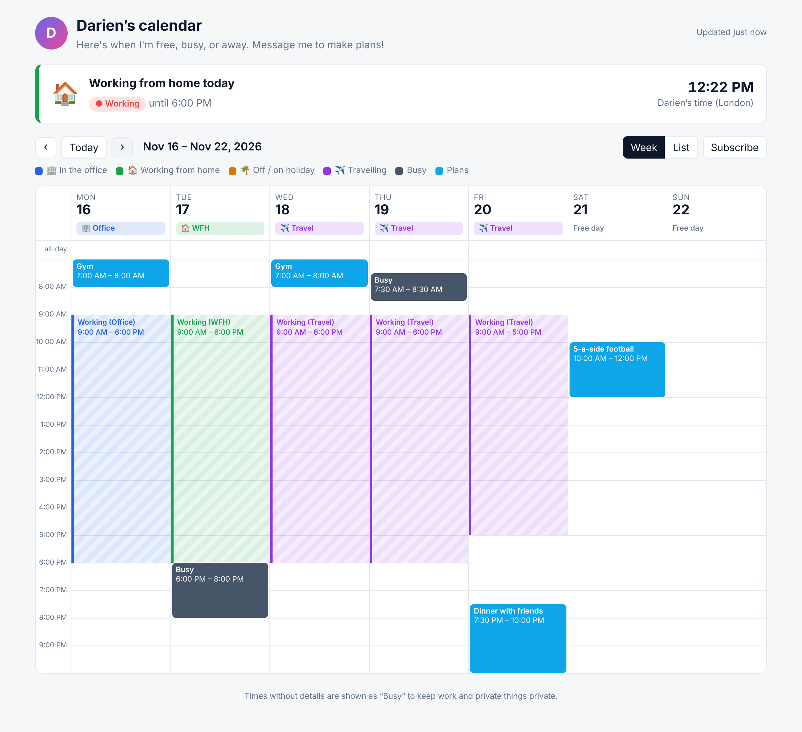

# Public Calendar

A shareable calendar for friends and family. It shows when you're free, blocks out your working hours, and highlights whether you're **🏠 working from home**, **🏢 in the office**, **✈️ travelling** or **🌴 off**. It syncs from your real work and personal calendars without exposing anything private.



- **Work calendar → "Busy" blocks.** Meeting titles, attendees, locations and descriptions are removed. Overlapping meetings are merged, and meetings inside your working hours are absorbed into the "Working" block, so nobody can tell how busy your work day really is.
- **Working hours** are shown as one block per day, colored by where you're working.
- **Location status per day** comes from a default weekly pattern (for example Tue/Fri WFH) that you override by adding all-day events like `WFH`, `Office`, `Travel to Lisbon` or `Annual leave`. Outlook out-of-office events are picked up automatically.
- **Personal events** show their titles. Add `#private` to an event to show it only as "Busy", or `#hide` to leave it out entirely.
- **"Right now" card**: friends see at a glance whether you're free, and if not, until when.
- **Follows you when you travel**: a `Travel to Tokyo` event moves that day's working hours to Tokyo time, and visitors see "Darien is in Tokyo · 1h ahead of you".
- **Every visitor sees their own timezone automatically**, detected from their device. No location permission is needed. They can switch to your current time or any other timezone.
- **Subscribe**: friends can add a cleaned-up `.ics` feed to Google, Apple or Outlook calendar.
- **Optional passcode**: the data file is AES-encrypted, so it stays private on a public host.
- Free to run: a static site rebuilt by GitHub Actions every 30 minutes. No server, no database. Your private calendar URLs never reach the browser.

```
 Work calendar (ICS) ─┐                              ┌─ index.html + data.json  → friends' browsers
                      ├─► GitHub Action (every 30m) ─┤
 Personal cal (ICS) ──┘   sanitize + merge + status  └─ calendar.ics           → friends' calendar apps
```

## Quick start (preview with sample data)

```bash
npm install
npm run dev        # builds from fixtures/ and serves http://localhost:8080
npm test
```

## Set it up for real

### 1. Get your calendars' secret ICS links

| Calendar | Where to find it |
|---|---|
| **Outlook / Microsoft 365** (work) | Outlook on the web → Settings → Calendar → *Shared calendars* → **Publish a calendar** → choose your calendar and "Can view all details" → copy the **ICS** link. (Titles are stripped during the build either way, but "all details" lets title rules like `WFH` or `Travel to …` on your work calendar work.) Some organisations disable publishing. If so, see [Alternatives](#if-your-work-calendar-cant-be-published). |
| **Google Calendar** (work or personal) | calendar.google.com → ⚙️ Settings → click the calendar → *Integrate calendar* → **Secret address in iCal format**. |
| **iCloud** | Calendar app → share calendar → **Public Calendar** → copy link (`webcal://` is fine). |

Treat these URLs like passwords. They only ever go into GitHub Secrets or your local `.env`.

### 2. Configure `calendar.config.json`

The most important settings:

```jsonc
"owner": { "name": "Darien", "timezone": "Asia/Singapore", "homeCity": "Singapore" },  // your home base
"workingHours": { "days": { "mon": ["09:00", "18:00"], ... } },
"defaultLocation": { "mon": "office", "tue": "wfh", ... },      // your usual hybrid pattern
```

- **`sources[].visibility`**: `busy` shows time only, `titles` adds event titles, `details` adds titles and locations.
- **`sources[].mergeBusy`**: merges overlapping busy blocks so meeting structure isn't revealed.
- **`statuses`**: labels, emoji, colors and priority (travel 40 beats off 30 beats WFH 20 beats office 10). `working: false` removes the working-hours block that day.
- **`statusRules`**: regexes matched against event titles. A named group `(?<detail>…)` becomes the detail shown next to the status, like "✈️ Travel · Lisbon". `busyStatus: "OOF"` matches Outlook out-of-office events.
- **`workingHours.hideWorkEventsInsideHours`**: when `true`, work meetings inside working hours are absorbed into the "Working" block.

### 3. Deploy to GitHub Pages

1. Push this repo to GitHub.
2. **Settings → Pages → Build and deployment → Source: GitHub Actions.**
3. **Settings → Secrets and variables → Actions → New repository secret**:
   - `WORK_ICS_URL`, `PERSONAL_ICS_URL` (required)
   - `CALENDAR_PASSCODE` (optional, makes the site passcode-protected)
   - `FEED_TOKEN` (optional, a long random string like `openssl rand -hex 16`; puts the subscribe feed at an unguessable URL. Required for a feed when a passcode is set.)
4. **Actions → "Sync calendars & deploy" → Run workflow.** After that it runs every 30 minutes.

Your calendar will be at `https://<username>.github.io/<repo>/`.

> GitHub Pages on a **private** repo requires a paid GitHub plan. On a public repo the code is public, but your calendar data isn't: it only exists in the built site, and URLs live in Secrets.
> GitHub pauses scheduled workflows in repos with no activity for 60 days. Re-enable it from the Actions tab if that happens.

It also works on **Netlify / Cloudflare Pages / Vercel**: build command `npm run build`, output directory `dist`, and the same environment variables. Use their scheduled build hooks to refresh it.

## How you use it day to day

| You want friends to see… | Do this in your calendar |
|---|---|
| WFH on a normally in-office day | All-day event titled `WFH` |
| In the office on a normally WFH day | All-day event titled `Office` |
| You're travelling | All-day event (spanning the days) titled `Travel to Tokyo`, `✈️ Tokyo` or `Trip: Tokyo` |
| You're on holiday | All-day `Holiday`, `Annual leave`, `PTO`, `OOO`, or an Outlook out-of-office event |
| A personal event as just "Busy" | Add `#private` to the title or description (or mark the event Private) |
| A personal event hidden completely | Add `#hide` |
| A work event with its title shown | Add `#public` |
| A personal event blocked in your work calendar (with sync-back on) | Add `#block`; use `#noblock` to opt out |
| Your timezone to follow you without changing your status (e.g. a month working remotely) | All-day event `📍 Bali` |
| A destination it can't recognise | Add `#tz:Asia/Makassar` to the event, or add an alias to `places` in the config |

Travel and holiday details (like "Tokyo") only appear when they come from a calendar with `titles` or `details` visibility, not from the busy-only work calendar.

## Sync-back: block personal time in your work calendar

Colleagues book you from your **work** calendar, which can't see your personal plans. Sync-back copies your personal commitments into the work calendar as **private** blocks, titled "Personal commitment" by default, so nobody books over your dentist appointment or school run.

What gets blocked (`syncBack.mode`):

| Mode | Blocks |
|---|---|
| `workingHours` (default) | Personal events that overlap your working hours, which is when people could book you |
| `tagged` | Only events with `#block` in the title or description |
| `all` | Every timed personal event |

- `#block` on any event always blocks it, even outside working hours. `#noblock` never blocks it.
- `bufferMinutes` (default 15) pads each block for travel time.
- `copyTitle: false` (default) keeps the real title out of your work calendar. Blocks are marked **private** either way, so colleagues only see "busy".
- `includeAllDay: true` also blocks all-day personal events like `Holiday - Langkawi`. Status markers such as `WFH`, `Travel to …` and `📍 …` are never blocked.
- It only manages the next `lookaheadDays` (30) days. When you move or delete the personal event, the block moves or disappears on the next run.

**Safety**
- It only ever edits or deletes events it created itself (tagged with a hidden marker). Your real work meetings are never touched.
- It skips a run if any calendar fails to load, so a temporary outage can't wipe your blocks.
- Logs show counts only, never titles, because Actions logs on a public repo are public.

### Set up (Google Workspace / Gmail work calendar, ~10 minutes, once)

1. Go to [console.cloud.google.com](https://console.cloud.google.com) **signed in with your work account** and create a project, e.g. "Personal calendar sync".
2. **APIs & Services → Library →** enable **Google Calendar API**.
3. **APIs & Services → OAuth consent screen →** User type **Internal**. This is available on Google Workspace accounts like synthesys.co: no Google review is needed and tokens don't expire. Add the scope `.../auth/calendar.events`.
   *If you only see "External", publish the app to "In production". Apps left in "Testing" have their tokens expire every 7 days.*
4. **Credentials → Create credentials → OAuth client ID →** Application type **Desktop app**. Copy the client ID and secret.
5. On your computer:
   ```bash
   GOOGLE_CLIENT_ID=... GOOGLE_CLIENT_SECRET=... npm run google:auth
   ```
   Open the link, sign in with your **work** account and approve. The terminal then prints a refresh token.
6. Add GitHub secrets: `GOOGLE_CLIENT_ID`, `GOOGLE_CLIENT_SECRET`, `GOOGLE_REFRESH_TOKEN`. Add `WORK_CALENDAR_ID` too if it isn't the account's primary calendar.
7. Set `"syncBack": { "enabled": true, ... }` in `calendar.config.json` and push.

To preview without writing anything, add the same values to `.env` and run `npm run sync-back:dry-run`.

> Outlook / Microsoft 365 work calendars need Microsoft Graph instead. That isn't built yet; ask if you need it.

## Travel and timezones

Your **home** timezone is `owner.timezone`. On days covered by a travel event, or a `📍 Place` event, the destination is matched to a timezone in this order:

1. A `#tz:Area/City` tag in the event
2. Your own `places` aliases in `calendar.config.json` (e.g. `"the cottage": "Europe/London"`)
3. A built-in list of common cities and countries (SF, NYC, KL, Bali, HK, Sydney, NZ…)
4. Any IANA timezone city name (Tokyo, Lisbon, Zurich…)

That day's working hours then follow local time. A trip on your busy-only work calendar still moves your timezone, but the page shows just the offset (`GMT+9`), not the city.

Visitors see times in **their own** timezone by default, detected from their device. The dropdown switches to *your current time* or any other zone.

## Sharing it: the easiest options

Everything starts with the hosted link from step 3 (GitHub Pages). Every option below reuses that link, so there's only one thing to maintain.

| Option | Effort | What people get |
|---|---|---|
| **Just send the link** | none | Works in any browser. On a phone, "Add to Home Screen" gives it an app icon. |
| **Telegram Mini App** | ~3 min | An "Open calendar" button inside a Telegram bot chat that opens the calendar full screen, in Telegram's theme. |
| **Notion embed** | ~30 s | The live calendar inside a Notion page. |
| **Subscribe feed** | none | Your schedule appears inside their own Google, Apple or Outlook calendar. |

### Telegram Mini App (no server needed)

1. In Telegram, message **@BotFather** → `/newbot` → choose a name and username (e.g. `darien_schedule_bot`).
2. `/mybots` → your bot → **Bot Settings → Menu Button → Configure menu button** → paste your site URL → button text `📅 Calendar`.
3. Optionally, `/newapp` → choose the bot → same URL. This gives a direct link like `t.me/darien_schedule_bot/calendar` that you can pin in family group chats.

The page detects Telegram, uses its light/dark theme, and opens subscribe links properly. The bot doesn't need any code. A bot that *replies* to messages, like `/now` → "Darien is free until 3pm", needs a small always-on service, such as a free Cloudflare Worker that reads `data.json`.

### Notion

In any Notion page, type `/embed` → paste the site URL → resize. It stays live because it is the same page. If you use a passcode, the "remember me" option may not persist inside Notion's frame, so visitors may need to re-enter it.

## If your work calendar can't be published

- **Outlook / M365**: forward a free/busy view to your personal Google Calendar, or ask IT to allow calendar publishing. Microsoft Graph (`/me/calendarView`) is another option, but it needs an Azure app registration.
- **Google Workspace**: share your work calendar's free/busy with your personal Google account, then use the personal calendar's secret ICS link.
- **Any calendar**: tools like Reclaim.ai or OneCal can mirror work meetings into a personal calendar as "Busy".

## Privacy model

- The build runs in GitHub Actions. Secret ICS URLs live in Secrets and are never logged or written to the output.
- Only the cleaned-up model is published. Work events become `Busy` (unless tagged `#public`). Descriptions, attendees and UIDs are never published, and event locations only for `details` sources.
- With `CALENDAR_PASSCODE`, `data.json` is encrypted with AES-256-GCM using a PBKDF2-SHA256 key (310k iterations). The page decrypts it in the browser, so a static host can serve it without exposing it. Pick a decent passphrase: anyone with the file can try to guess it offline.
- `noindex` stops search engines from listing the page.

## Project layout

```
calendar.config.json   your settings
src/build.js           fetch → sanitize → write dist/
src/ics-reader.js      ICS parsing + recurrence expansion (node-ical)
src/model.js           privacy rules, day status, working-hours blocks
src/ics-writer.js      subscribable feed
src/crypto.js          optional passcode encryption
src/sync-back.js       mirror personal commitments into the work calendar
src/google.js          tiny Google Calendar API client
scripts/google-auth.js one-time sign-in to get a refresh token
public/                the web app (vanilla HTML/CSS/JS, no build step)
fixtures/              sample calendars for `npm run dev`
test/                  node:test suite
```
